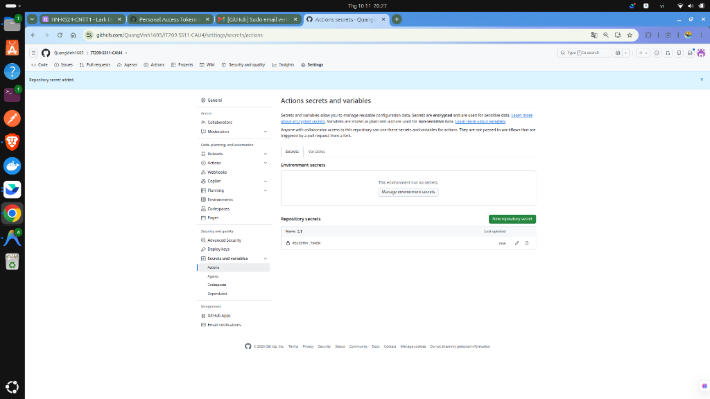

# Bài Tập DevOps - Session 11: CI/CD với GitHub Actions & Container Registry

- **Học viên:** Nguyễn Quang Vinh (Vinh Nguyen)
- **Tài khoản GitHub:** `QuangVinh1605`
- **Môn học:** DevOps (IT209)
- **Repository:** [QuangVinh1605/IT209-SS11-CAU4](https://github.com/QuangVinh1605/IT209-SS11-CAU4)

---

## Danh Sách Bài Tập Trong Buổi Học
- **Bài 4 (EX4):** Khai báo GitHub Secrets và cấu hình Đăng nhập Container Registry (GHCR)
  - Thư mục chi tiết: [`homework/session_11/ex4/`](homework/session_11/ex4/README.md)
  - Workflow file: [`.github/workflows/ci.yml`](.github/workflows/ci.yml)

---

## Tóm tắt Cấu hình Bài 4 (EX4)

### 1. Kịch bản GitHub Actions (`.github/workflows/ci.yml`)
Workflow thực hiện kiểm tra đăng nhập tự động vào GitHub Container Registry (`ghcr.io`) thông qua `docker/login-action@v3` sử dụng secret `REGISTRY_TOKEN`:

```yaml
name: CI Workflow - Container Registry Login

on:
  push:
    branches:
      - main
      - master
  pull_request:
    branches:
      - main
      - master
  workflow_dispatch:

jobs:
  login-registry:
    name: Kiểm tra Đăng nhập Container Registry
    runs-on: ubuntu-latest

    permissions:
      contents: read
      packages: write

    steps:
      - name: Checkout mã nguồn repository
        uses: actions/checkout@v4

      - name: Đăng nhập vào GitHub Container Registry
        uses: docker/login-action@v3
        with:
          registry: ghcr.io
          username: ${{ github.actor }}
          password: ${{ secrets.REGISTRY_TOKEN }}

      - name: Xác nhận trạng thái đăng nhập
        run: |
          echo "=========================================="
          echo "Đăng nhập GHCR thành công!"
          echo "Tài khoản GitHub Actor: ${{ github.actor }}"
          echo "Registry: ghcr.io"
          echo "Workflow Run ID: ${{ github.run_id }}"
          echo "=========================================="
```

### 2. Các bước triển khai & kiểm tra
1. Tạo Personal Access Token (classic) với quyền `write:packages` tại [GitHub Token Settings](https://github.com/settings/tokens).
2. Lưu token vào Repository Secret với tên `REGISTRY_TOKEN` tại [Repository Actions Secrets](https://github.com/QuangVinh1605/IT209-SS11-CAU4/settings/secrets/actions).
3. Đẩy mã nguồn lên nhánh `main`: `git push origin main`.
4. Mở tab **Actions**, kiểm tra log bước *Đăng nhập vào GitHub Container Registry* đạt `Login Succeeded!`.

### 3. Minh chứng thực hiện
- **Ảnh Repository Secret REGISTRY_TOKEN:**
  

