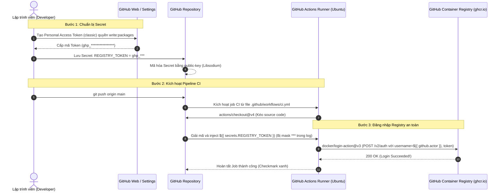

# Báo Cáo Thực Hành: Khai Báo GitHub Secrets và Cấu Hình Đăng Nhập Container Registry (GHCR)

## Thông tin bài tập
- **Học viên:** Nguyễn Quang Vinh (Vinh Nguyen)
- **Mã sinh viên / Tài khoản GitHub:** `QuangVinh1605`
- **Môn học:** DevOps (IT209) - Session 11
- **Bài tập:** Bài 4 (EX4) - Khai báo GitHub Secrets và cấu hình Đăng nhập Container Registry
- **Đường dẫn nộp bài:** `homework/session_11/ex4/`
- **Kho lưu trữ GitHub:** [QuangVinh1605/IT209-SS11-CAU4](https://github.com/QuangVinh1605/IT209-SS11-CAU4)

---

## 1. Mục tiêu bài thực hành
1. **Quản lý bí mật bảo mật an toàn (Repository Secret):**
   - Khởi tạo Personal Access Token (classic) trên GitHub cấp quyền chuyên biệt `write:packages`.
   - Lưu trữ bí mật vào GitHub Repository Secrets với khóa `REGISTRY_TOKEN`, đảm bảo nguyên tắc an toàn thông tin (Principle of Least Privilege & Zero Trust), tuyệt đối không để lộ token vào mã nguồn hay lịch sử commit Git.
2. **Cấu hình tự động hóa CI/CD xác thực GitHub Container Registry (GHCR):**
   - Thiết lập quy trình GitHub Actions thông qua tệp `.github/workflows/ci.yml`.
   - Tích hợp Action chính thức `docker/login-action@v3` để đăng nhập vào Registry máy chủ `ghcr.io` bằng tài khoản ngữ cảnh `${{ github.actor }}` và mật khẩu bảo mật `${{ secrets.REGISTRY_TOKEN }}`.
3. **Kiểm tra và kiểm chứng kết quả thực thi:**
   - Đẩy mã nguồn lên repository GitHub.
   - Theo dõi pipeline tự động kích hoạt trên tab **Actions**.
   - Mở chi tiết bước `Đăng nhập vào GitHub Container Registry` và xác nhận kết quả trả về `Login Succeeded`.

---

## 2. Kiến trúc & Cơ chế xác thực (Authentication Architecture)

### 2.1. Sơ đồ luồng hoạt động (Workflow Flowchart)



### 2.2. Chi tiết các thành phần kỹ thuật

| Thành phần | Vai trò & Đặc điểm kỹ thuật |
| :--- | :--- |
| **GitHub Container Registry (GHCR)** | Registry lưu trữ Docker Images của GitHub (`ghcr.io`). Cho phép gắn trực tiếp quyền quản lý Package với Repository/Organization, hỗ trợ phân quyền granular access. |
| **Personal Access Token (PAT)** | Token cá nhân thay thế mật khẩu truyền thống khi xác thực qua API/CLI. Scope `write:packages` cho phép tải lên (push) và cập nhật image vào GHCR. |
| **GitHub Secrets (`REGISTRY_TOKEN`)** | Cơ chế mã hóa không đối xứng của GitHub. Dữ liệu được mã hóa tại tầng client trước khi gửi lên server GitHub. Trong toàn bộ log thực thi, chuỗi này tự động bị ẩn (`***`). |
| **`docker/login-action@v3`** | Action chuẩn hóa của tổ chức Docker Inc., giúp thiết lập phiên làm việc Docker daemon an toàn trên runner, tự động cấu hình file `~/.docker/config.json`. |

---

## 3. Cấu hình tệp kịch bản `.github/workflows/ci.yml`

Tệp cấu hình CI đặt tại đường dẫn `.github/workflows/ci.yml` và được nhân bản tại `homework/session_11/ex4/ci.yml`:

```yaml
name: CI Workflow - Container Registry Login

on:
  push:
    branches:
      - main
      - master
  pull_request:
    branches:
      - main
      - master
  workflow_dispatch:

jobs:
  login-registry:
    name: Kiểm tra Đăng nhập Container Registry
    runs-on: ubuntu-latest

    permissions:
      contents: read
      packages: write

    steps:
      - name: Checkout mã nguồn repository
        uses: actions/checkout@v4

      - name: Đăng nhập vào GitHub Container Registry
        uses: docker/login-action@v3
        with:
          registry: ghcr.io
          username: ${{ github.actor }}
          password: ${{ secrets.REGISTRY_TOKEN }}

      - name: Xác nhận trạng thái đăng nhập
        run: |
          echo "=========================================="
          echo "Đăng nhập GHCR thành công!"
          echo "Tài khoản GitHub Actor: ${{ github.actor }}"
          echo "Registry: ghcr.io"
          echo "Workflow Run ID: ${{ github.run_id }}"
          echo "=========================================="
```

---

## 4. Hướng dẫn từng bước thực hành (Step-by-Step Implementation)

### Bước 1: Khởi tạo Personal Access Token (classic) trên GitHub
1. Đăng nhập vào GitHub, nhấp vào ảnh đại diện góc trên cùng bên phải -> chọn **Settings**.
2. Ở menu bên trái, cuộn xuống dưới cùng chọn **Developer settings**.
3. Chọn mục **Personal access tokens** -> **Tokens (classic)** (Đường dẫn trực tiếp: [https://github.com/settings/tokens](https://github.com/settings/tokens)).
4. Nhấn **Generate new token** -> chọn **Generate new token (classic)**.
5. Điền thông tin:
   - **Note:** `REGISTRY_TOKEN_GHCR` (hoặc tên gợi nhớ bài học).
   - **Expiration:** Chọn `30 days` hoặc `90 days`.
   - **Select scopes:** Tích chọn quyền:
     - `write:packages` (Hệ thống sẽ tự động tích kèm `read:packages`).
     - *(Tùy chọn khuyến nghị)*: Tích thêm `repo` và `delete:packages` nếu muốn toàn quyền quản lý kho lưu trữ.
6. Cuộn xuống cuối trang và nhấn nút xanh **Generate token**.
7. **Sao chép (Copy) chuỗi mã token ngay lập tức** (Token có tiền tố `ghp_...`). *Lưu ý: GitHub chỉ hiển thị token này duy nhất một lần.*

---

### Bước 2: Thiết lập Secret `REGISTRY_TOKEN` trong Repository
1. Truy cập vào Repository bài tập trên GitHub:
   [https://github.com/QuangVinh1605/IT209-SS11-CAU4](https://github.com/QuangVinh1605/IT209-SS11-CAU4)
2. Nhấn vào tab **Settings** của repository (ở thanh menu nằm trên cùng).
3. Tại thanh bên trái, cuộn tới mục **Security** -> chọn **Secrets and variables** -> nhấn **Actions**.
   *(Hoặc truy cập nhanh qua URL:* [https://github.com/QuangVinh1605/IT209-SS11-CAU4/settings/secrets/actions](https://github.com/QuangVinh1605/IT209-SS11-CAU4/settings/secrets/actions)*)*
4. Nhấn nút xanh **New repository secret**.
5. Nhập chính xác thông tin:
   - **Name:** `REGISTRY_TOKEN`
   - **Secret:** Dán chuỗi mã token `ghp_...` đã sao chép từ Bước 1.
6. Nhấn nút xanh **Add secret**.
7. **Chụp ảnh màn hình:** Chụp lại giao diện bảng *Repository secrets* hiển thị biến `REGISTRY_TOKEN` vừa tạo để làm minh chứng nộp bài.

---

### Bước 3: Đẩy mã nguồn và kịch bản CI lên GitHub
Thực thi các lệnh Git tại thư mục dự án trên máy trạm:

```bash
# Kiểm tra trạng thái file
git status

# Thêm tất cả các file cấu hình vào staging
git add .

# Tạo commit
git commit -m "feat: setup CI workflow with ghcr login action and repository secret"

# Đẩy code lên nhánh main của repository
git push -u origin main
```

---

### Bước 4: Kiểm tra kết quả thực thi trên GitHub Actions
1. Mở trình duyệt, truy cập tab **Actions** của Repository:
   [https://github.com/QuangVinh1605/IT209-SS11-CAU4/actions](https://github.com/QuangVinh1605/IT209-SS11-CAU4/actions)
2. Chọn lần chạy workflow mới nhất (Workflow run có commit message vừa đẩy).
3. Nhấp vào job **Kiểm tra Đăng nhập Container Registry** (hoặc `login-registry`).
4. Mở chi tiết bước **Đăng nhập vào GitHub Container Registry**:
   - Xác nhận log hiển thị dòng:
     ```text
     Logging into ghcr.io...
     Login Succeeded!
     ```
   - Trạng thái toàn bộ Job hiển thị dấu tích xanh (Success :white_check_mark:).

---

## 5. Danh mục sản phẩm nộp bài
Theo yêu cầu đề bài, sản phẩm hoàn thiện bao gồm:
1. **Tệp kịch bản CI:** [`.github/workflows/ci.yml`](file:///.github/workflows/ci.yml) (đã có bước `docker/login-action@v3`).
2. **Tệp sao lưu kịch bản:** [`homework/session_11/ex4/ci.yml`](file:///homework/session_11/ex4/ci.yml).
3. **Tệp báo cáo tổng hợp:** [`homework/session_11/ex4/README.md`](file:///homework/session_11/ex4/README.md).
4. **Minh chứng hình ảnh:**
   - Ảnh chụp màn hình trang **Settings -> Secrets and variables -> Actions** hiển thị secret `REGISTRY_TOKEN`.
   - Ảnh chụp màn hình chi tiết log trên GitHub Actions hiển thị **`Login Succeeded`**.
